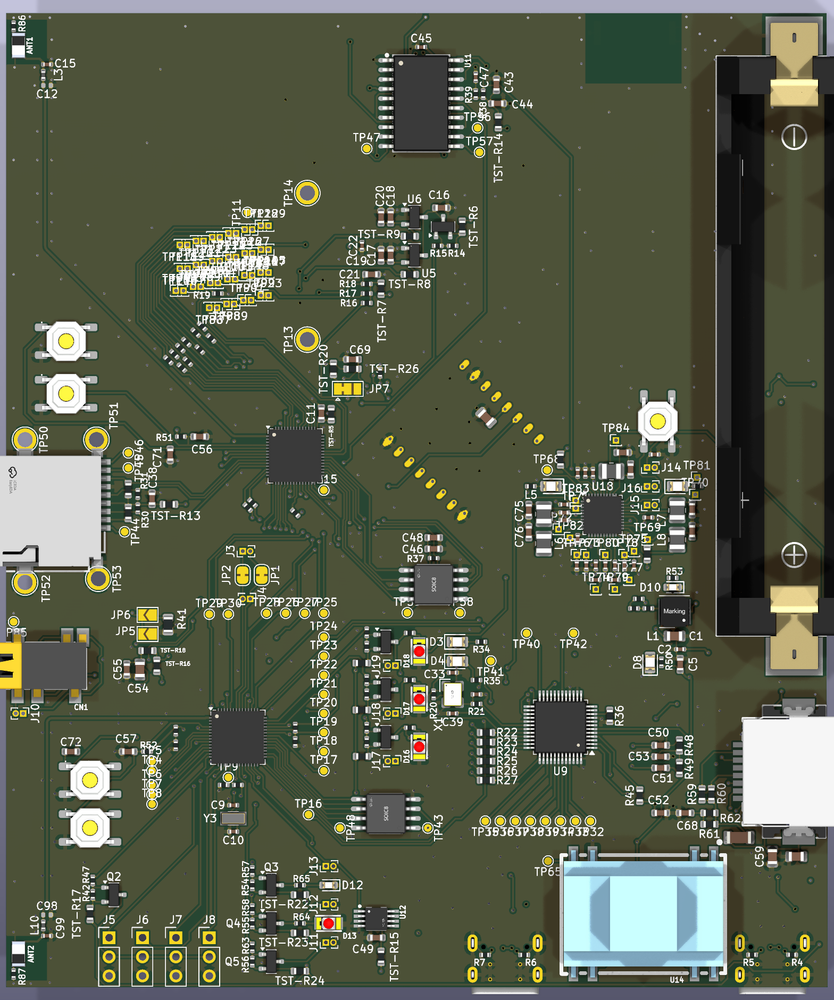
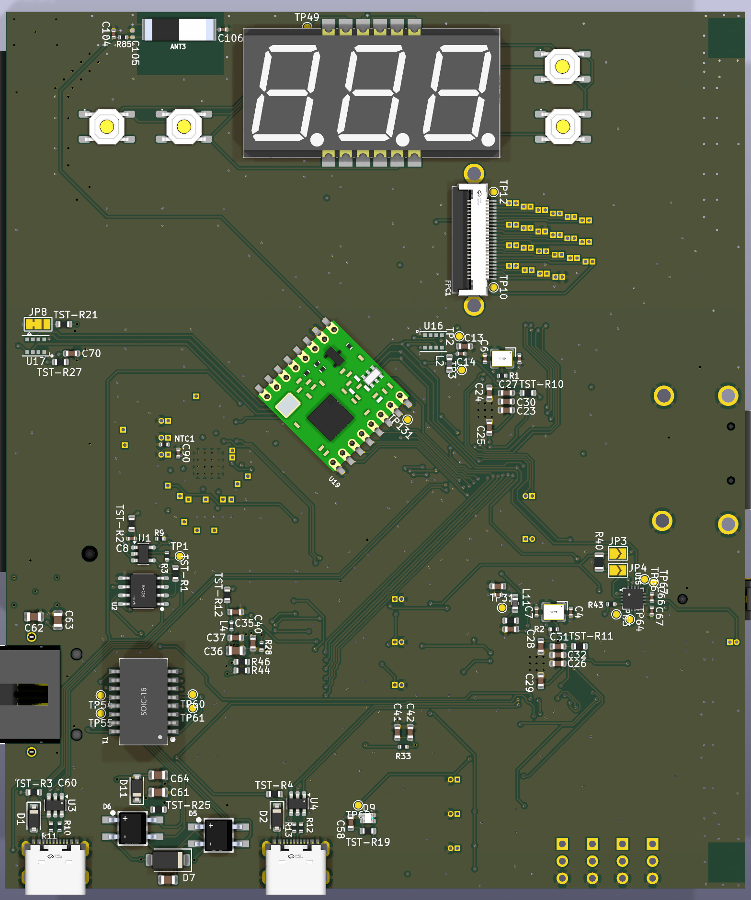

# ESP32S3_Audio_Cam_POE

This is a PCB layout for ESP32S3 with OV2640 / OV5640 camera. It was designed in KiCad 9 and converted to KiCad 10 (10.0.8); the files no longer open in KiCad 9.
The boards major features include:
* Camera.
* 2 way audio.
* Hardwired Ethernet including POE.
* Camera pan / tilt servos and lamp control.
* record to SD card.
* misc outputs to drive misc motors or similar outputs. 
* Battery powered option with Lion type of battery. 
* Stream video to NVR recording station. 

## Firmware
Firmware found here https://github.com/jharvey/ESP32-CAM_MJPEG2SD


Changes up to version 0.1:
* Initial layout
* Converted to KiCad 10.
* Removed the Medium and Smaller cost-reduction variants.

## Purpose

The layout design intent is to make a hardwired intercom system which includes options for camera, making a near equivilant of a doorbell camera. Hardwired means it's not susceptibale to RF jaming, or similar attacks. It can be battery powered at the ethernet switch source so it can handle power outagaged. Lighting controls allow night time spot light, and day time spot light controls. Pan, Tilt, Rotate could potentailly allow a laser pointer to distract bad players if things go bump in the night. 


## Installation
Clone with the JLCPCB library submodule, which the symbol and footprint tables point to:

```
git clone --recurse-submodules https://github.com/jharvey/ESP32S3_Audio_Cam_POE.git
```

All JLCPCB symbols, footprints and 3D models resolve from this submodule, so you do not need the JLCPCB library installed through the KiCad Plugin and Content Manager. Other 3D models use KiCad's standard `${KICAD10_3DMODEL_DIR}` library.

On Windows, if the submodule fails with "Filename too long" or "'$GIT_DIR' too big", enable long paths first (`git config --global core.longpaths true`) or clone to a shorter folder.


TBD currently has not had it's first spin. TBD


## 3D case
See 3D case found here
TBD create file in OnShape and post link here. TBD

## 3D pictures from KICAD
<div align="center">


</div>
