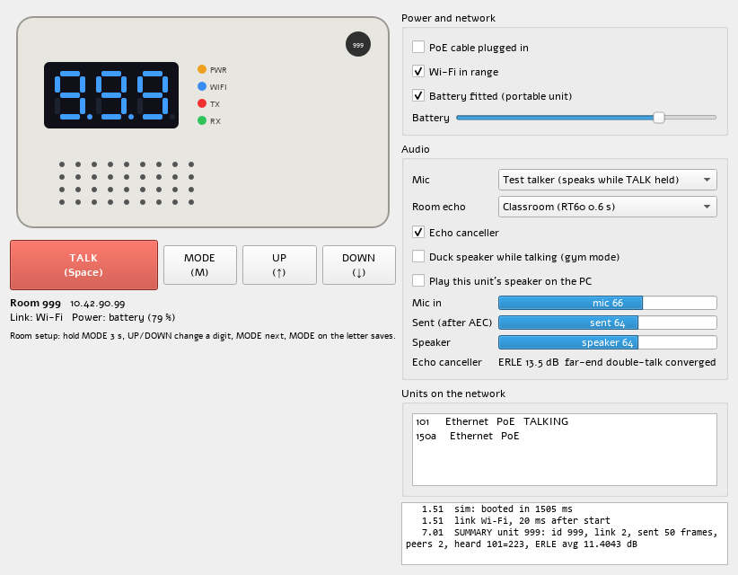
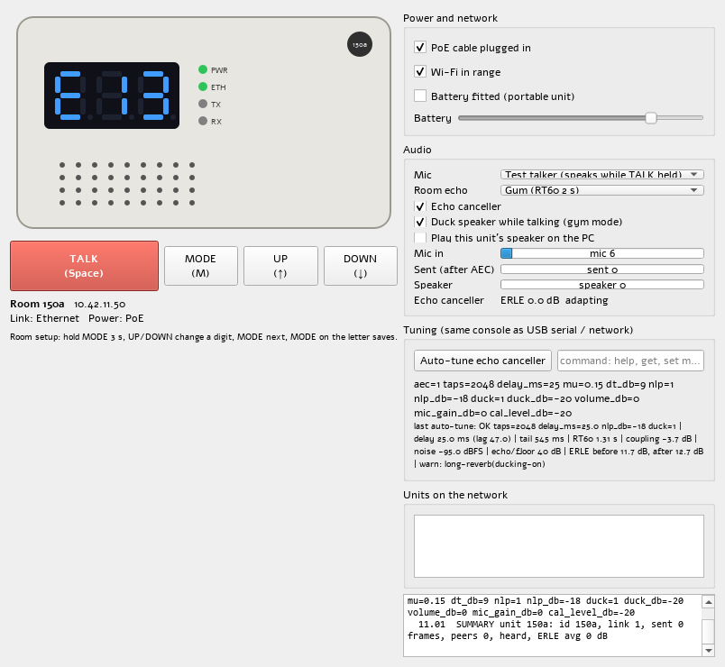
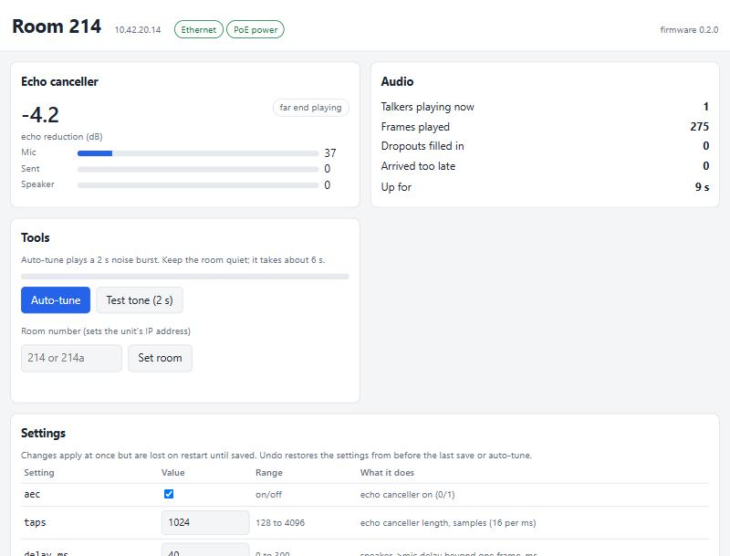
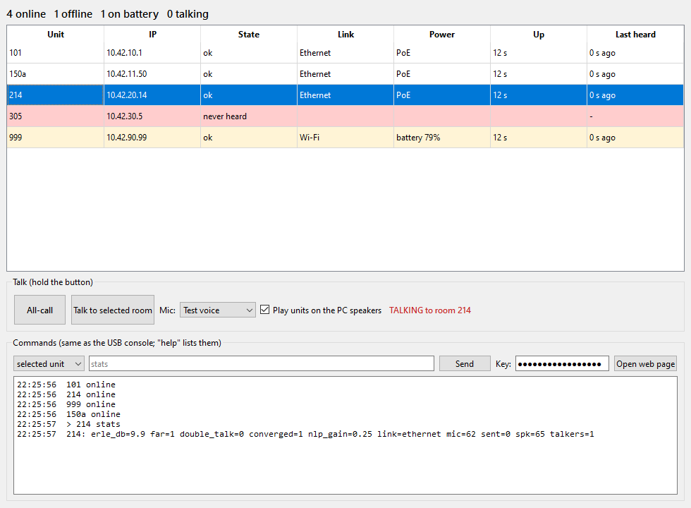

# Intercom firmware

Firmware for the ESP32S3_Audio_Cam_POE classroom intercom, plus a PC simulator that runs
the same code. The plan is in [Docs/firmware_plan.md](../Docs/firmware_plan.md).



## Layout

| Path | What |
|---|---|
| `src/core/` | The intercom itself, plain C++17 with no Arduino calls: packets, jitter buffer, multi-talker mixer, NLMS echo canceller, link failover, room-number setup. Built unchanged into both the firmware and the simulator. |
| `src/board/Pins.h` | ESP32-S3 pin map from the schematic netlist. |
| `src/board/Tm1637.*`, `Panel.h` | Front-panel display and buttons (TM1637 through the TCA9555), plain C++ so the PC tests check it. |
| `src/main.cpp` | ESP32-S3 drivers behind the core's interfaces. **Compiles; not tested on hardware yet.** |
| `tools/` | `update-unit.bat` / `unit_tool.py`: USB firmware updates and first-time setup. |
| `sim/` | Qt desktop simulator and the `ic-selftest` checks. |
| `sim/console/` | `intercom-console`: the office console (room grid, all-call, talk to a room, signed commands). |
| `sim/netsim/` | `ic-netsim`: a whole-school network load simulation (switches, uplinks, QoS, Wi-Fi, emergency video). Results are in [Docs/network_sim_results.md](../Docs/network_sim_results.md). |

## What works today (in the simulator)

- Push-to-talk all-call: every unit hears whoever holds TALK, and several talkers at once are mixed (loudest 4).
- Room groups: several units with the same room number (`150a`, `150b` in the gym) don't play each other back.
- Echo cancellation on every unit, tested against simulated echo. With residual-echo suppression:
  - Classroom: about 16 dB, 20 dB with suppression.
  - Gym (2 s reverb): about 8 dB, 20 dB with suppression.
  - People talking in the room still come through while the far end plays.
- PoE / Wi-Fi failover: unplugging a battery unit moves it to Wi-Fi in one 20 ms frame. Plugging in moves it back after 200 ms.
- Room number = IP address, set on the unit's buttons: room 214 → 10.42.20.14, 214a → 10.42.21.14.
- Status beacons: every unit lists the others with link, power and battery.

## Echo canceller tuning: auto-tune plus manual override

The simulator's numbers are starting points. Real rooms, cases and speakers will differ, so every
unit can measure itself, and every setting can be changed by hand.



### Auto-tune

Start it by holding **UP for 5 s** on the panel, or with the console command `cal` (or the web page).
It takes about 6 s and needs a quiet room. TALK cancels it. The display shows `c42` (progress) while it runs.

> The board reads its buttons through the TM1637 display chip, which reports **one key at a time**,
> so two-button combos can't work on the hardware. MODE + UP for 3 s still works in the simulator.

On the ESP32 the analysis after the measurement runs in a low-priority task, so audio keeps
playing while it works (it takes a few seconds on the S3).

1. It measures the room noise.
2. It plays a 2 s noise burst and records the mic, then records 1 s of silence.
3. From the recording it works out:

   | Measurement | How | Used for |
   |---|---|---|
   | Speaker → mic delay | cross-correlation | `delay_ms` |
   | Reverb time (RT60) | how fast the room goes quiet after the burst | `taps`, gym ducking |
   | Case coupling | mic level vs speaker drive | warnings |
   | Noise floor | the quiet recording | warnings |

4. It replays the recording through the echo canceller with the old settings and several new filter lengths, and keeps the best.
5. It sets the residual echo suppression depth (`nlp_db`) and turns ducking on for long reverb.
6. It saves the result. `undo` brings back the previous settings.

Afterwards the display shows `e17` (17 dB of echo reduction) or `err`.

Auto-tune refuses to run in a noisy room. It also reports "no clear echo" when the speaker or mics aren't working, so it doubles as a hardware check.

Simulator results:

| Case | Result |
|---|---|
| 12 ms hardware latency | found 12.1 ms |
| 40 ms hardware latency | found 40.0 ms; echo reduction 14.4 → 19.2 dB |
| 150 ms latency (beyond the default filter) | echo reduction −0.3 → 19 dB |
| Classroom | RT60 measured 0.5 s |
| Gym | RT60 measured 1.3 s, ducking switched on |

The thresholds behind these decisions are tuned in the simulator, so treat them as first guesses until real rooms confirm them.

### Manual override: the console

The same text commands work in three places:
- **USB serial:** 115200 baud, native USB port.
- **Network:** from the office console or `intercom-sim --send`, signed with the network key.
- **Simulator:** the command box in the window.

| Command | What it does |
|---|---|
| `help` | list commands and parameters with their ranges |
| `get [key ...]` | show parameters |
| `set key value [key value ...]` | apply now; not saved until `save` |
| `save`, `load`, `defaults`, `undo` | keep, revert, factory reset, restore previous |
| `cal`, `cal result` | auto-tune, and the last measurements |
| `stats` | live ERLE, double-talk, link, levels |
| `unit 214a` | set the room number (and IP) without using the buttons |
| `tone [seconds]` | play a 1 kHz test tone on the unit's speaker |
| `talk [seconds\|off]` | transmit as if TALK were held (default 5 s). For bring-up before the panel works. **USB only.** |
| `selftest`, `selftest result` | board check: which chips answer, Ethernet link, PSRAM, and a tone the mic must hear |
| `version` | firmware version |
| `webpass <password>` | set the web interface password; `webpass off` turns the web interface off. **USB only.** |
| `netkey <key>` | set the network command key (16+ characters); `netkey off` refuses all network commands. **USB only.** |

Parameters:

| Parameter | Meaning |
|---|---|
| `aec` | echo canceller on/off |
| `taps` | echo canceller filter length |
| `delay_ms` | speaker → mic delay |
| `mu` | adaptation step |
| `dt_db` | double-talk threshold |
| `nlp`, `nlp_db` | residual echo suppression on/off and depth |
| `duck`, `duck_db` | speaker ducking while TALK is held, on/off and depth |
| `volume_db` | speaker volume |
| `mic_gain_db` | gain on the sent audio |
| `cal_level_db` | auto-tune noise burst level |

Over the network, from the simulator build (or the office console):

```bat
intercom-sim --send "214 get" --key <network key>
intercom-sim --send "214 set mu 0.1 nlp_db -18" --key <network key>
intercom-sim --send "all cal result" --key <network key>
```

The target is `all`, a room (`214`, every unit in it) or one unit (`214a`).

**Network key.** Units refuse network commands until a key is set over USB (`netkey`).
- Every command is signed with the key (HMAC-SHA256), including its target, so it can't be changed or re-addressed.
- Each command carries the sender's clock in ms. A unit only accepts a number higher than the last one it took, and remembers it across restarts, so a recorded command can't be replayed.
  - Office PCs need a correct clock: one running behind is refused with "old or repeated command".
- `talk`, `webpass` and `netkey` are refused over the network even when signed.
- Commands and replies aren't encrypted, so keep the intercom on its own VLAN.

## Web interface

Each unit serves its own page at its IP address, for example `http://10.42.20.14` for room 214.



The page shows and does:

| Section | Contents |
|---|---|
| Header | room, IP, Ethernet / Wi-Fi, PoE / battery, firmware version |
| Echo canceller | live echo reduction, double talk, mic / sent / speaker levels |
| Audio | talkers playing, dropouts filled in, late packets, uptime |
| Tools | auto-tune with a progress bar, test tone, set room number |
| Settings | every parameter with its range; apply, save, undo, reload, factory defaults |
| Last auto-tune | the measurements from `cal result` |
| Other units heard | every unit's link, power and battery: a quick health check of the school from any unit |
| Console | the same commands as USB |

Security:
- **Off until a password is set over USB** with `webpass <password>` (8 characters or more). It can't be set or changed from the network or the web page.
- **Login:** the browser asks for a password (any user name).
  - The password is stored as a salted, slow hash, never as text.
  - 5 wrong passwords lock the page for 30 s.
- **No firmware upload.** Updates are USB only.
- **Cross-site protection:** commands need a header that other websites can't send.
- **Not encrypted (plain HTTP).** Keep the intercom on its own VLAN.

In the simulator, `run-sim.bat` starts each unit with its page on localhost:

| Unit | Address |
|---|---|
| 101 | http://localhost:8101 |
| 214 | http://localhost:8214 |
| 150a | http://localhost:8150 |
| 150b | http://localhost:8151 |
| 999 | http://localhost:8999 |

Log in with any user name and the demo password `intercom-demo`. That password exists only in the simulator: real units get theirs over USB.
For a single unit: `intercom-sim --name 214 --web-port 8214 --web-pass <password>`.

## Office console

`intercom-console` is the office PC app. It works the same with simulated units and real ones.



- **Room grid:** every unit's link, power, battery and uptime.
  - Talking units are highlighted.
  - Units on battery are yellow; red below 25 %.
  - Units not heard for 3.5 s are red **OFFLINE**.
  - With `--rooms` or `--rooms-file`, units that were never heard show up too, so a dead unit is noticed before an emergency.
- **All-call** and **Talk to selected room**: hold the button. Uses the PC microphone, or a test voice. Only the chosen room hears a room call.
- **Hears every unit** that talks, mixed on the PC speakers.
- **Commands:** to the selected unit, its room, or all units, signed with the network key. Replies show in the log.
- **Open web page** for the selected unit.

```bat
intercom-console --key <network key> --rooms-file rooms.txt
```

Not built yet: emergency mode (no alarm button) and listen-in.

## Simulator

Build (Windows, the same Qt MinGW kit as the T-Deck Pro simulator; no extra Qt modules needed):

```bat
firmware\sim\build-sim.bat
```

This also runs `ic-selftest`, which must print `ALL PASS`.

Run:

```bat
firmware\sim\run-sim.bat
```

This starts a demo set: rooms 101 and 214, gym units 150a/150b, and portable unit 999. They use the demo network key
`intercom-demo-key`, so the office console can talk to them:

```bat
firmware\sim\build\intercom-console.exe --key intercom-demo-key --rooms 101,150a,150b,214,999
```

To start a single unit, pass a name and options:

```bat
firmware\sim\run-sim.bat 305 --echo gym
```

- **Keys:** Space = TALK, M = MODE, arrow keys = UP/DOWN.
- **Hardware switches:** the right-hand panel has PoE, Wi-Fi range, battery, the mic source (synthetic talker or the PC mic) and the room echo.
- **Hearing a unit:** tick "Play this unit's speaker on the PC" on one unit.
- **Network:** units talk over real UDP multicast (239.255.42.1:5004), so simulators on other PCs on the LAN join in. Windows may ask to allow network access the first time.
- **Echo canceller code:** the simulator uses the portable NLMS canceller. On the ESP32 the plan is the ESP-SR audio front end, so final tuning happens on hardware.

Scripted run (no window), prints a `SUMMARY` line:

```bat
intercom-sim --name 101 --headless --auto-talk 3,2 --quit-after 8
```

## Firmware build

Compiles with no errors or warnings (Arduino-ESP32 3.2.0 on ESP-IDF 5.4, via the pioarduino platform in `platformio.ini`).
Not run on hardware yet. The first-board checklist is in [Docs/bring-up.md](../Docs/bring-up.md).

```bat
cd firmware
pio run
```

Where the files live:
- **Espressif framework and libraries (~1.5 GB):** on the NAS at `M:\pio` (`core_dir`).
- **Compiler (1.3 GB):** a local copy at `C:\pio-tc`. Windows won't run programs from the NAS share ("Access is denied"), so `platform_packages` links it in.
  - To set up on another PC, copy `M:\pio\packages\toolchain-xtensa-esp-elf` to `C:\pio-tc\`.
- **Build output:** local, in `firmware\.pio`.

The NAS is slow, so a clean build takes about 50 minutes. Rebuilds after small changes are much faster.
If that's too slow, move `core_dir` to a local short path such as `C:/pio`.

## USB updates and first-time setup

Updates are USB only. `tools/update-unit.bat` makes each room visit one command.
It uses PlatformIO's own Python, so nothing extra needs installing.

1. **Build and publish a release:**
   ```bat
   cd firmware
   pio run
   tools\update-unit.bat release
   ```
   This copies the four flash images and a `manifest.json` into `M:\ESP32S3_Audio_Cam_POE\releases\<version>`.
   Bump `kFirmwareVersion` in `src/core/Config.h` for each release.
2. **Update a unit:** plug the laptop into the unit's USB-C port and run `tools\update-unit.bat`.
   - It reads the unit's room and version first.
   - It flashes the newest release.
   - It checks the unit comes back with the new version **and the same room number**.
   - It never erases flash, so the room number, tuning, web password and network key are kept.
3. **New unit:**
   ```bat
   tools\update-unit.bat setup --flash --unit 214 --webpass <password> --netkey <key> --selftest
   ```
   Add `--burn-efuse` on boards with the camera on GPIO45, to fix the flash voltage permanently (see [bring-up](../Docs/bring-up.md)).

Every update and setup is logged to `updates.csv` in the releases folder.
If more than one Espressif device is plugged in, the tool won't guess: pass `--port COMx`.
